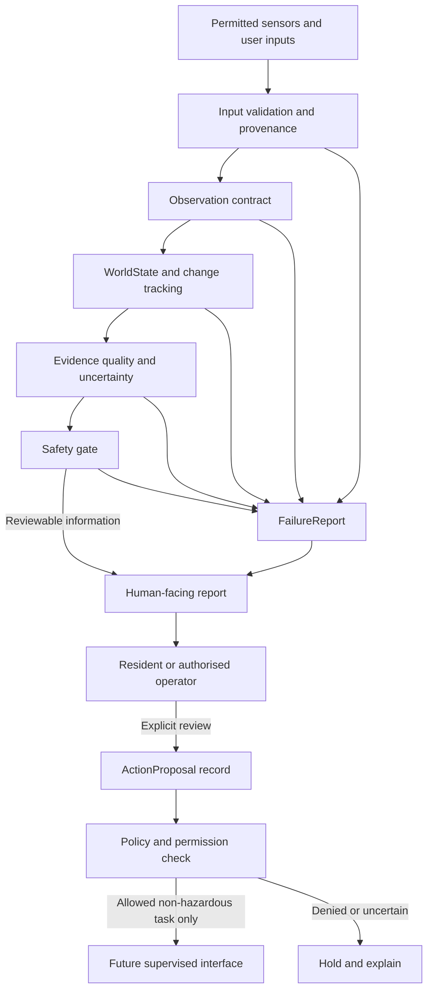

# PUI89 AI Home Assistant Robot — System Architecture

**Status:** Proposed logical architecture; not an implemented or validated end-to-end system.  
**Principle:** Evidence first, uncertainty preserved, human authority retained.

## 1. Logical data flow

The diagram describes intended boundaries, not completed connections. The future supervised interface is not an enabled actuator pathway. No model output may directly command motors, locks, breakers, valves, appliances or safety devices.

## 2. Components and responsibilities

| Component | Responsibility | Required safeguards |
|---|---|---|
| Input adapters | Accept only supported sensor formats and user inputs. | Size/rate limits, type/range checks, source identity and safe parsing. |
| Observation | Store a timestamped, unit-aware measurement or proposal. | Provenance, calibration/health, quality, location and uncertainty. |
| WorldState | Maintain a versioned view of known conditions by zone. | Separate observed facts from inferred or predicted state. |
| Change tracking | Compare current evidence with a verified baseline. | Cite both records; handle drift, missing data and baseline changes. |
| Evidence evaluator | Assess freshness, consistency and confidence limitations. | Unknown is not safe; no unsupported probability claims. |
| Safety gate | Allow, hold or block a proposal under explicit rules. | Fail closed for uncertain or hazardous conditions. |
| Human-facing report | Explain known, unknown, changed, failing and recommended items. | Plain language, traceable evidence and clear limitations. |
| ActionProposal | Record a proposed next step for human review. | No execution authority; explicit reviewer and decision record. |
| FailureReport | Record input, model, software, sensor and workflow failures. | Preserve evidence, timestamps and recovery outcome. |

## 3. Shared PUI89 AI Core contracts

The intended contracts are `Observation`, `WorldState`, `ActionProposal` and `FailureReport`. Each contract must be versioned and validated. HOME-specific fields must not silently change the shared schema; use documented extensions and compatibility tests.

The project integration register currently marks these contracts and related safety integration **not verified** until implementation and test evidence are linked: [shared AI Core integration register](shared-ai-core-integration.json).

## 4. Trust boundaries

Treat sensor firmware, model outputs, images/text, network messages, downloaded files, dependencies and repository contributions as untrusted inputs. Validate data at each boundary. Models may propose observations; they do not define truth or grant authority.

## 5. Data lifecycle

1. Collect only a supported and consented signal.
2. Validate format, source, timestamp, unit and sensor health.
3. Store only the minimum evidence needed for the stated purpose.
4. Generate a report with source links and uncertainty.
5. Apply the documented retention period.
6. Support authorised export and deletion, including derived data where applicable.

Retention periods, encryption design, access roles and backup handling remain **TBD** and must be decided before collecting resident data.

## 6. Failure behaviour

- Invalid or stale data: mark unknown and report the reason.
- Sensor disconnect or drift: stop relying on that sensor; do not infer a safe state.
- Network loss: preserve safe local behaviour; do not require cloud access for emergency procedures.
- Model timeout or malformed output: reject output and create a failure record.
- Localisation or obstacle uncertainty: hold/stop movement if a physical prototype is ever introduced.
- Safety-gate failure: deny proposal progression and preserve the failure record.

## 7. Architecture acceptance

Architecture review passes only when every implemented component has a defined input/output contract, trust boundary, failure behaviour, owner, tests and evidence reference. A diagram alone does not establish implementation.
